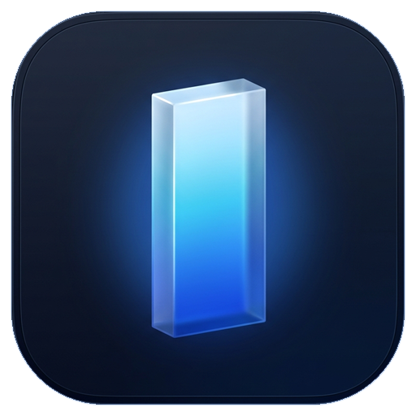

<p align="center">
  
</p>

<h1 align="center">Monolith</h1>

<p align="center">
  <strong>Spatial Glass Desktop Dock & Live Widget Taskbar for Windows 10 & Windows 11</strong>
</p>

<p align="center">
  <a href="https://github.com/monolth/Monolith/releases/latest">
    
  </a>
  <a href="https://github.com/monolth/Monolith/actions/workflows/build.yml">
    
  </a>
  <a href="LICENSE">
    
  </a>
</p>

## Download & Uninstallation

- **Installer (Recommended):** [Download MonolithSetup.exe](https://github.com/monolth/Monolith/releases/latest/download/MonolithSetup.exe)
- **Portable (No Install):** [Download Monolith.exe](https://github.com/monolth/Monolith/releases/latest/download/Monolith.exe)
- **All Releases:** [github.com/monolth/Monolith/releases](https://github.com/monolth/Monolith/releases)

> **Windows SmartScreen Note:** Monolith is an independent open-source project and the GitHub releases are currently unsigned, so Windows SmartScreen may show an *"Unknown publisher"* prompt on first launch (click **More info → Run anyway**). Every release is built transparently from this public repository via [GitHub Actions](https://github.com/monolth/Monolith/actions), or you can compile it locally from source in 5 seconds using `.\build.ps1`.

To uninstall Monolith, use **Windows Settings → Apps → Installed Apps → Monolith → Uninstall**, or re-run `MonolithSetup.exe` / `MonolithUninstall.exe` to cleanly remove all files and restore the default Windows taskbar.

**Monolith** is a lightweight, open-source **Spatial Glass desktop dock & live widget taskbar** for Windows 10 and Windows 11, built natively in C# / WPF (.NET Framework 4.x) with zero external runtime or SDK dependencies.

## Features

- **Floating Capsule & Full-Width Windows 11 Taskbar Modes** — Use Monolith as a floating optical-glass stadium pill OR switch to Full-Width edge-to-edge mode with centered apps (Windows 11) or left-aligned apps and right-anchored widgets, clock & system controls.
- **Spatial Glass Design & Real-Time Optical Refraction** — Full stadium-pill floating dock with live wallpaper lens refraction, glowing active indicators, **8 Themes** (*Spatial Glass, Prism Glass, Aurora Glass, Glacier Frost, Midnight, Obsidian Neon, Ceramic White, Clear*), **12 Dock Glass Color Tints** + Tint Strength control, and **18 Accent Colors** + Custom `#HEX` picker.
- **18 Live Icon Glass Styles** — Switch instantly between *Squircle Glass, Circle Orb, Dark Crystal, Borderless, Sharp Prism, Glow Pedestal, Neon Ring, Double Glass, Wide Capsule, Ambient Aura, HUD Brackets, Diamond Crystal, Titanium Chrome, Hexagon Crystal, Holographic, Organic Leaf, Neumorphic Inset,* and *Dotted Tech* with live previews.
- **Animated Dock Backgrounds & Interactive Region Cropper** — Upload looping `.gif`, `.mp4 / .wmv / .mov / .avi`, or static `.png / .jpg / .webp` files directly inside the dock capsule. Drag the live selection window over any part of an animated GIF/video/image to play that exact region with zero aspect-ratio distortion, use seamless side-by-side Tiling, or pick from 3 built-in GPU-animated presets (*Aurora Flow, Cyber Neon, Sunset Lava*). Auto-pauses in fullscreen games.
- **Unified Windows Taskbar & High-Res Icon Engine** — Pinned apps and running windows merge cleanly with zero duplicates, full native 64×64 icon extraction for Microsoft Store / UWP apps, Steam games, and elevated Win32 apps, 60 FPS GPU DWM Live Window Previews with fast close (`✕`), Start button left-click (`Win`) + right-click Power User menu, anchored Windows Hidden Icons (`^`), and 1-click Windows Notifications (`Win+N`) & Show Desktop (`Win+D`).
- **Integrated Windows 11 Search (`Ctrl + Shift + Space`)** — Anchored cleanly above Monolith (no taskbar overlap), indexing all installed Win32, Microsoft Store / UWP (`shell:AppsFolder`), and Steam apps alongside Windows Search Index files, 18+ `ms-settings:` shortcuts, live math calculator, and web search — while keeping native Windows `Win+S` and Start Menu search 100% functional.
- **Customizable Windows 11 Control Center** — Edit in place with the `✎` button (or from Settings): switch between *Windows 11*, *Compact*, and *Glass Cards* styles, 3 corner shapes, S/M/L sizes, 12 reorderable quick action tiles, clickable Mute volume slider, WMI brightness slider, Now Playing media controls, and Power row.
- **29 Live Modular Widgets** — Drag-and-drop widget ordering across Clocks, System, Media & Audio, Productivity, Weather, Finance, and AI & Developer categories.
- **Zero-Bounce Native AppBar & Crash-Safe Restoration** — Supports *Smart Dodge*, *Reserve Space* (native Windows AppBar), and *Float Over* modes, and always restores the native Windows taskbar cleanly on exit or crash.

## Keyboard Shortcuts

| Shortcut | Action |
|---|---|
| `Ctrl + Shift + Space` | Open Integrated Search & Calculator |
| `Ctrl + Shift + W` | Open All Widgets Gallery |
| `Ctrl + Shift + S` | Open Monolith Settings |
| `Ctrl + Shift + F11` | Toggle Dock Visibility |

## Building from Source

Requires only Windows 10/11 (uses the built-in .NET Framework 4.x `csc.exe` compiler — no external SDK or NuGet downloads needed):

```powershell
# Build standalone Monolith.exe
powershell -ExecutionPolicy Bypass -File .\build.ps1

# Build standalone MonolithSetup.exe installer
powershell -ExecutionPolicy Bypass -File .\build_installer.ps1
```

## Privacy & Security

This program will not transfer any information to other networked systems unless specifically requested by the user or the person installing or operating it.

- Monolith runs **100% locally** on your Windows PC and collects **zero telemetry, analytics, or personal data**.
- Optional online widgets (Weather, Crypto/FX, GitHub Heatmap), if explicitly enabled by the user, only fetch public read-only API data.
- All release binaries (`Monolith.exe` and `MonolithSetup.exe`) are built directly from this public source repository via automated GitHub Actions workflows (`.github/workflows/build.yml`).

## License

Released under the [MIT License](LICENSE).
